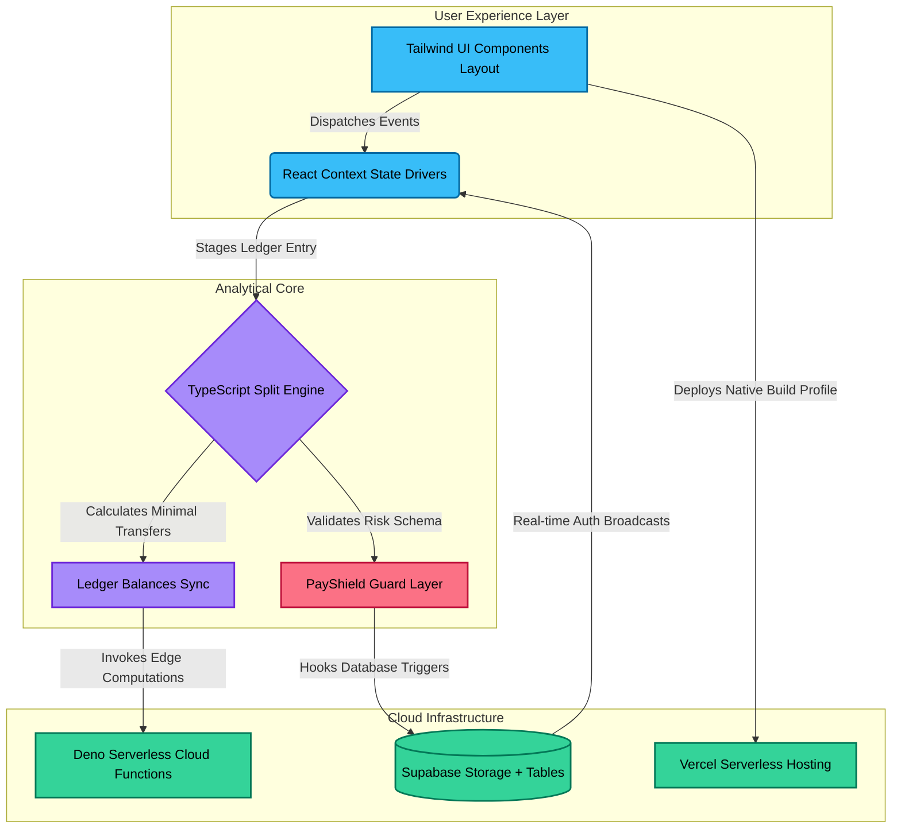

# 📊 FinTrack & PayShield: Premium Financial Intelligence & Split Suite

Welcome to the comprehensive technical showcase of **FinTrack** (powered by **PayShield**), a full-stack, enterprise-grade personal finance, group budgeting, and automated security verification web ecosystem.

Built with an advanced architecture featuring **Vite, React, TypeScript, Tailwind CSS, and full Supabase cloud function automation**, this app isn't just about parsing mathematical debt splits—it's an interactive financial hub equipped with structural guards to securely host real-time expense ecosystems.

---

## 🎨 Interactive Architecture Visualized



---

## 💎 High-Tier Features & Modules

### ⚡ Deep Analytical Accounting
* **Minimal Matrix Settlements:** Powered by a customized graph calculation logic (`splitEngine.ts`), our codebase handles high-complexity inter-group settlements. It reduces messy multi-person cash loops into single, concise debt balances.
* **Daily Spending Real-Time Trend Charts:** Renders beautiful interactive graphics matching your structural timeline metrics via visual responsive data canvases (`IncomeExpenseTrend.tsx`, `ExpenseDonut.tsx`).

### 🛡️ PayShield Automated Security Layer
* **Dynamic Risk Evaluation:** The core architecture passes incoming transactional inputs through a dedicated analysis sandbox (`payshieldEngine.ts`). This ensures suspicious patterns or anomalies flag instant UI alerts before syncing databases.
* **Automatic Financial Statement OCR Parser:** Backed by an edge-deployed cloud backend script (`parse-statement/index.ts`), users can quickly upload raw statements to parse items automatically into readable forms.

### ⚙️ Scalable Database Integrity & Isolation Guards
* **Secure Partitioning SQL:** Includes custom schema definitions (`migrations/`) with multi-tenant row security rules, developer authorization validations, and anti-spam verification limits (`username_cooldown.sql`).
* **Strict Participant Block Guards:** Complex business logic (`participant_expenses_block_guard.sql`) prevents users from editing historical transactions if groups are locked or archived.

---

## 📂 Deep Dive: Project File Architecture

Here is your repository's layout, detailing exactly how the modules operate together:

```text
FinTrack/
├── src/
│   ├── components/
│   │   ├── ui/               # Strictly structured atomic component designs (cards, dynamic dialogs)
│   │   ├── payshield/         # Threat gauges, trend metrics graphs, network mapping engines
│   │   ├── dashboard/        # Active portfolio status heroes, quick-action utilities
│   │   └── groups/           # Smart splitting modulations, settle-up overlays, UPI payment setups
│   ├── hooks/                # Global states (budgets, active chat layers, notifications trackers)
│   ├── lib/                  # Graph isolation suites, testing matrices, financial dynamic filters
│   ├── contexts/             # Real-time state contexts managing Auth instances and currency indices
│   └── pages/                # Application routes (Reports, Settings, Security Hubs, Debts Dashboard)
├── supabase/
│   ├── migrations/           # Complete chronological database schema setup instructions
│   ├── tests/                # Verification specs enforcing split structural logic rules
│   └── functions/            # Autonomous Deno cloud script configurations deployed to edge instances
├── public/                   # Service worker scripts enabling Progressive Web App (PWA) actions offline
├── vercel.json               # Enterprise cloud engine routing and reverse-proxy deployment maps
└── tailwind.config.ts        # Design ecosystem configurations and tokens
```

---

## 🛠️ Step-by-Step Local Deployment

Follow these quick commands to fire up your local environment:

### 1. Project Initialization & Dependency Check
Make sure you have Node.js installed on your machine.

```bash
# Enter the workspace folder
cd FinTrack

# Install clean node package structures flawlessly
npm install
```

### 2. Environment Configuration
Duplicate the structural sandbox format template to initialize credentials:

```bash
cp .env.example .env
```

Open your newly minted `.env` file and append your secure client project variables:

```env
VITE_SUPABASE_URL=https://supabase.co
VITE_SUPABASE_ANON_KEY=your-secure-public-anon-token-string
```

### 3. Spin up the Vite Engine
Launch the client development stack with instant hot-reloading:

```bash
npm run dev
```
Open your browser and navigate to **`http://localhost:5173`** to test your application!

---

## 🔒 Automated Testing Protocols

Maintain strict development guidelines. Run our internal automated unit tests to verify database constraints, graph state configurations, and edge isolation limits before push procedures:

```bash
# Execute local split ledger calculations verify test cases
npm run test
```

---

## 🌐 Production Architecture & Vercel Deployment

* **PWA Cache Capabilities:** Integrated `sw.js` modules enable background asset hydration, keeping components fully interactive under unstable network paths.
* **Vercel Routing:** The core repository features custom single-page-app redirection layouts natively mapped within `vercel.json` to handle client routers cleanly. When deploying to Vercel, point your **Root Directory** setting directly to `/FinTrack`.
*
